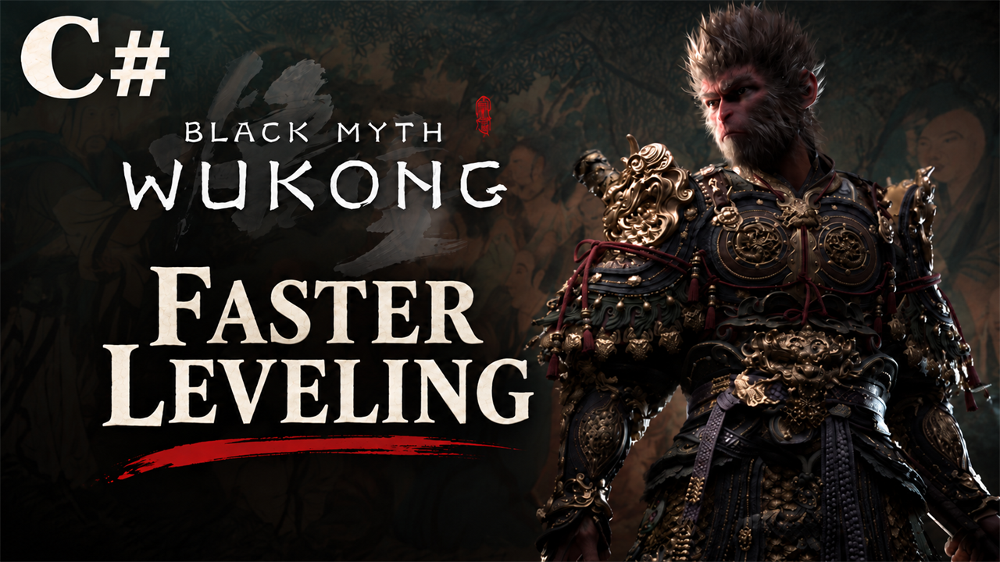

# Faster Leveling (C#)

Levels come faster: every level needs less XP. You set the divider in config.json (default 2 = half the XP). Needs C# Loader.

## What it does

Every level needs less XP. The mod divides the game's XP for each level by a number you choose in `config.json`. You
gain XP as usual (enemies, bosses, everything else), so you reach each level faster.

| Level | XP for the next level in the game | Divider 2 (default) | Divider 3 |
|---|---|---|---|
| 1 | 342 | 171 | 114 |
| 10 | 814 | 407 | 272 |
| 50 | 4,416 | 2,208 | 1,472 |
| 100 | 11,848 | 5,924 | 3,950 |
| 200 | 19,898 | 9,949 | 6,633 |
| 342 | 38,912 | 19,456 | 12,971 |
| Level 1 to 342 in total | 5,878,823 | 2,939,489 | 1,959,727 |

- Values are rounded up, so a level never costs less than the game's XP divided by your number.
- Each level still gives 1 talent point, and the max level stays the same. Enemies, XP drops and New Game+ are not
  changed.
- A C# mod for C# Loader. It changes no game files: it changes the game's level table in memory while the game runs,
  so it needs no `-fileopenlog`. With the default divider 2 it does the same as
  [Faster Leveling](https://github.com/KintaroModding/wukong_fasterleveling), the pak version.

## Screenshots

## How to install

1. Install [C# Loader](https://github.com/KintaroModding/b1csharploader/releases/latest) v1.0.1 or newer:
   copy the `b1` folder of its zip into the game folder.
2. Download the zip of the latest release of this mod on GitHub (`wukong_fasterleveling_cs_<version>.zip`).
3. Copy the `b1` folder of the zip into the game folder, too. It adds the folder
   `b1\Binaries\Win64\CSharpLoader\Mods\wukong_fasterleveling_cs\`.
4. Start the game.

To check that it runs: the mod writes `wukong_fasterleveling_cs.log` into its folder, and with `Console=1` in
`CSharpLoader\b1cs.ini` the loader's console shows the line `[Faster Leveling (C#)] <version> loaded.`

To update the mod, copy the `b1` folder of the new release over the old one. To remove it, delete the folder
`CSharpLoader\Mods\wukong_fasterleveling_cs\`.

## How to use

Nothing to do: the mod works as soon as you load a game.

`config.json` in the mod's folder holds the setting:

- `XpDivider`: the game's XP for each level is divided by this number. `2` = half the XP (default), `3` = a third,
  `1` = the game's values. From 1 to 100; decimals like `1.5` work.
- `"Enable": false` turns the mod off.

Changes apply at the next game start. With `Develop=1` in `CSharpLoader\b1cs.ini` (the loader's default), Ctrl+F5 in the
game reloads the C# mods and so applies a change at once.

- With a save that already has XP toward the next level, that XP counts against the new, lower amount: you may level
  up at your next XP gain.
- Levels you gain stay in your save when you remove the mod.

## Compatibility

- Game version: 1.0.21 (`1.0.21.23831`).
- Tested with C# Loader v1.0.1. The mod uses no hooks, so it does not need `EnableJit=1`.
- Do not use it together with the pak version, [Faster Leveling](https://github.com/KintaroModding/wukong_fasterleveling)
  (`wukong_fasterleveling_P.pak`): the divider would apply to the already halved table, and each level would need a
  quarter of the XP. The mod writes a warning into its log when it finds that file in `Paks\~mods`.
- A pak mod that replaces the level table (`PlayerLevelDesc`) works with this one: this mod divides the values of that
  mod's table. Mods that change enemies or drops work next to it.
- It reads the level table that the game loads, so a game update that changes the XP values needs no new version of
  this mod. A game update that changes the game's code may need one.

## Known issues

None yet.

## How to build

The mod is a .NET Framework 4.7.2 DLL, built with the .NET SDK 8 or newer against the game's C# DLLs and the mod API of
C# Loader: `build.ps1 -GameDll <folder> -ModBase <file>`. `README.md` has the details.

## Credits

Made by Kintaro. MIT license: you may use, change and share this mod. C# Loader was created by
[czastack](https://github.com/czastack/B1CSharpLoader). Black Myth: Wukong belongs to its makers.
